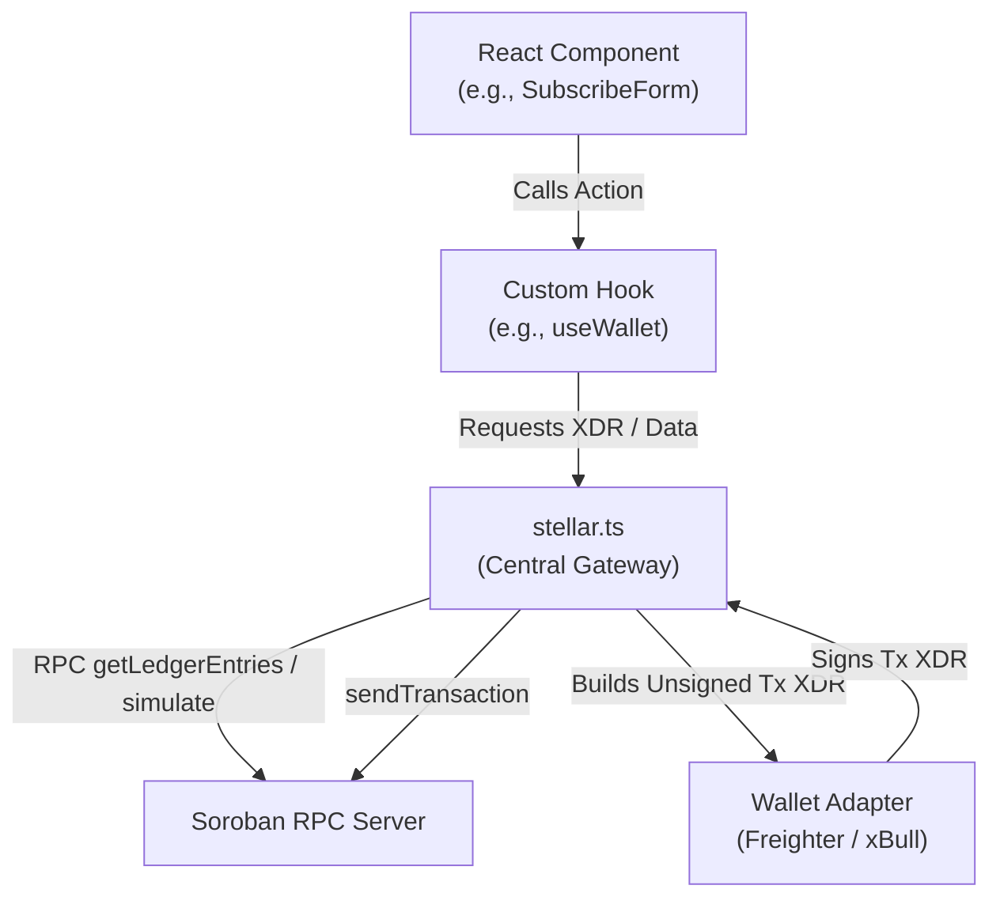

# Frontend Architecture Guide

This document provides the high-level architecture, technology stack, directory organization, and design patterns for the PayFlow web application.

> **Component Reference**: For detailed prop signatures, types, and component-level API documentation, see [`docs/FRONTEND-COMPONENTS.md`](FRONTEND-COMPONENTS.md).  
> **Component Inventory**: For the full inventory of canonical vs. unmounted components and single-source validation rules, see [`docs/frontend/COMPONENTS.md`](frontend/COMPONENTS.md).  
> **Contributing Guide**: For development setup, coding standards, styling tokens, accessibility requirements, and testing conventions, see [`docs/CONTRIBUTING-FRONTEND.md`](CONTRIBUTING-FRONTEND.md).

---

## Table of Contents

- [Overview & Principles](#overview--principles)
- [Technology Stack](#technology-stack)
- [Directory Structure](#directory-structure)
- [Blockchain Integration (`stellar.ts`)](#blockchain-integration-stellarts)
  - [Read Operations](#read-operations)
  - [Write Operations](#write-operations)
  - [Simulation preview before signing](#simulation-preview-before-signing)
- [Hook Composition Pattern](#hook-composition-pattern)
- [Wallet Architecture & Multi-Wallet Support](#wallet-architecture--multi-wallet-support)
- [Component Tree & Application Hierarchy](#component-tree--application-hierarchy)
  - [Provider Hierarchy](#provider-hierarchy)
  - [Complete Mounted Tree](#complete-mounted-tree)
  - [Tab Navigation & Admin View](#tab-navigation--admin-view)
- [State Management Strategy](#state-management-strategy)
  - [Local State](#local-state)
  - [Custom Hooks](#custom-hooks)
  - [Context Providers](#context-providers)
- [Related Documentation](#related-documentation)

---

## Overview & Principles

The PayFlow frontend is a client-side React + TypeScript single-page application built with [Vite](https://vitejs.dev/). It provides a non-custodial interface for recurring payments and subscriptions on the Stellar network using Soroban smart contracts.

The frontend is architected around strict separation of concerns:

- **Presentation**: UI components in `src/components/` focus exclusively on rendering and user interaction. Components do not call `@stellar/stellar-sdk` directly.
- **Business Logic**: Reusable state, asynchronous workflows, and contract data transformations are encapsulated in custom React hooks under `src/hooks/`.
- **Blockchain Gateway**: All smart contract and Soroban RPC interactions route through `src/stellar.ts`.
- **Service Utilities**: Network caching, transaction queuing, and wallet adapters live under `src/services/`.

---

## Technology Stack

| Technology | Purpose |
| --- | --- |
| **React 18** | Declarative component-based user interface |
| **TypeScript 5** | End-to-end static typing and contract type definitions |
| **Vite** | Fast development server and production bundler |
| **@stellar/stellar-sdk** | Soroban transaction building, XDR serialization, and RPC client |
| **Wallet Adapters** | Multi-wallet support (Freighter, xBull, Lobstr, Hana, Albedo, Rabet, WalletConnect) via modular adapters |
| **Vanilla CSS** | Token-driven styling (`index.css`) with CSS custom properties and light/dark theme support |
| **Vitest & RTL** | Unit, component, and integration testing with jsdom |

---

## Directory Structure

```
frontend/src/
├── components/          # Reusable UI components
│   └── admin/           # Administrative panels (batch pause, whitelist, repair)
├── context/             # React context providers (RPC health, shortcuts, toasts)
├── hooks/               # Custom hooks encapsulating state & business logic
├── pages/               # Route-level page shells (AdminDashboard)
├── services/            # Shared utilities, RPC cache, txQueue, and wallet adapters
│   └── wallets/         # Modular wallet adapter implementations
├── utils/               # Formatting, error translation, and validation helpers
├── App.tsx              # Main application shell and tab router
├── constants.ts         # Numeric limits, contract defaults, and interval presets
├── index.css            # Global design tokens and component styling
├── main.tsx             # Application bootstrap and root provider tree
├── stellar.ts           # Centralized blockchain and Soroban contract gateway
└── types.ts             # Core frontend TypeScript interfaces
```

Each directory has a dedicated responsibility:
- **components** contain reusable presentation UI.
- **hooks** encapsulate business logic and contract side effects.
- **services** provide shared utilities, RPC caching, and wallet adapters.
- **stellar.ts** acts as the centralized blockchain gateway.

Canonical vs unmounted component modules and single-source validation-rule owners: [`frontend/COMPONENTS.md`](frontend/COMPONENTS.md).

---

## Blockchain Integration (`stellar.ts`)

`frontend/src/stellar.ts` is the single source of truth for all on-chain interactions. Components never import `@stellar/stellar-sdk` directly; all queries and mutations flow through `stellar.ts` functions.



### Read Operations

Read operations query contract state without spending gas or prompting for wallet signatures:

- Querying subscriber records (`getSubscription(user)`)
- Checking token allowances (`getAllowance(user, contractId)`)
- Reading trial period metadata (`getTrialEnd(user)`)
- Fetching merchant revenue and daily history (`getMerchantRevenue`, `getMerchantRevenueHistory`)
- Verifying contract pause status (`isContractPaused`)
- Reading daily spending limits and window status (`getDailyLimit`, `getDailySpent`)

### Write Operations

Write operations construct, simulate, and request signatures for transactions that modify ledger state:

1. **Build Transaction**: Create an unsigned Stellar transaction using `@stellar/stellar-sdk` and contract invocation operations.
2. **Simulate**: Simulate the transaction against Soroban RPC to calculate resource fees and verify preconditions. `buildTx` caches the simulation result as a `TxSimulationPreview` keyed by the assembled XDR.
3. **Preview**: `useTransactionPreview` rebuilds the XDR when a confirmation modal opens and reads the cached (or fresh) preview. `TransactionPreview` renders the estimated resource fee in stroops/XLM and any simulated contract error code with its friendly message. The admin batch panels pass this state into `ConfirmModal`, which disables Confirm for blocking failures.
4. **Sign**: Request signing from the user's connected wallet adapter.
5. **Submit & Poll**: `useTransaction` refuses to enqueue a mutation whose preview has `blockSigning: true`, unless the caller passes `allowSimulationOverride: true` for a failure the preview marked `overrideAllowed`. It then submits the envelope and polls until confirmation.
6. **Parse Results**: Decode return values and error codes, returning a typed result to the calling hook.

#### Simulation preview before signing

Only benign conditions the contract re-checks itself (`#6` IntervalNotElapsed, `#9` GracePeriodElapsed, `#24` SubscriptionAlreadyActive) are marked safe to override. Allowance, limit and fee failures are always blocking. The fee/error preview is also attached to every entry created through `useTransaction` and rendered in `TxQueuePanel`, so all queued mutations expose their simulation outcome. RPC-level simulation failures do not block signing — the contract remains the authoritative guard.

Tests: `src/__tests__/useTransactionPreview.test.ts`, `src/__tests__/ConfirmModal.preview.test.tsx`, `src/__tests__/useTransaction.simulation.test.tsx`, and `src/__tests__/TxQueuePanel.test.tsx`.

---

## Hook Composition Pattern

Components remain presentational by delegating complex state and effects to custom hooks. Rather than managing wallet connections, intervals, and responsive layouts inline, components compose specialized hooks:

```tsx
export default function Dashboard({ userKey, onSign, refreshTrigger }: DashboardProps) {
  const { isMobile } = useResponsive();
  const { toast } = useToast();
  const { subscription, loading, refresh } = useSubscriptionSync(userKey, refreshTrigger);
  const { pause, resume, isPending } = usePauseResume(userKey, onSign);

  // Component focuses entirely on JSX rendering and event routing
}
```

Key architectural hooks:

- `useWallet()`: Connects, disconnects, tracks public keys, and handles signing across wallet adapters.
- `useNetworkStatus()`: Validates the connected wallet's network passphrase and polls for network switches; wallet adapters are also polled for account changes so dashboard hooks receive the new account without a reload.
- `useAdmin(publicKey)`: Checks whether the connected account is the contract administrator.
- `useContractPaused()`: Monitors protocol pause status and circuit-breaker conditions.
- `useRpcHealthContext()`: Tracks RPC endpoint latency, failure rates, and circuit breaker status.
- `useSubscriptionSync(userKey)`: Synchronizes on-chain subscription state with automatic polling and cache invalidation.

The notification centre stores per-category success, error, and general-update preferences in `localStorage`. Disabled categories are filtered before entering the toast and notification queues.

The merchant dashboard can export daily revenue buckets as CSV. Revenue amounts are represented exactly in both stroops and XLM; the day buckets are loaded through the contract's paginated revenue-day reader.

---

## Wallet Architecture & Multi-Wallet Support

Wallet management is decoupled from specific browser extensions through the `WalletAdapter` interface (`src/services/wallets/WalletAdapter.ts`):

1. **Detection**: `AVAILABLE_WALLETS` (`src/hooks/useWallet.ts`) registers every supported adapter and `WalletSelectModal` calls `isInstalled()` on each in parallel.
2. **Connection Flow**:
   - The user selects a wallet in `WalletSelectModal`.
   - The adapter requests account authorization.
   - The active public key is persisted to `localStorage` for session resumption.
3. **Network Gating**: `useNetworkStatus` compares the wallet network against `VITE_NETWORK_PASSPHRASE`. If mismatched, an actionable gate banner prompts the user to switch networks before executing writes.
4. **Transaction Signing**: When a write transaction is initiated, the active adapter prompts the user to sign the transaction XDR.

### Supported adapters

| Adapter | `id` | Availability | Install guidance |
| --- | --- | --- | --- |
| Freighter | `freighter` | Browser extension | https://freighter.app |
| xBull | `xbull` | Browser extension | https://xbull.app |
| Lobstr | `lobstr` | Browser extension | https://lobstr.co |
| Hana | `hana` | Browser extension | https://hanawallet.com |
| Albedo | `albedo` | Injected `window.albedo` provider | https://albedo.link |
| Rabet | `rabet` | Injected `window.rabet` provider | https://rabet.io |
| WalletConnect | `walletconnect` | Injected `window.walletConnect` mobile bridge | https://walletconnect.com |

Adding a wallet requires only a new `WalletAdapter` implementation under `src/services/wallets/` and one entry in `AVAILABLE_WALLETS`. `WalletSelectModal` is adapter-driven, so new wallets appear automatically.

Adapters expose optional `installUrl` and `installHint` fields. When `isInstalled()` returns `false`, the modal renders the hint and a "Get <wallet>" link so unavailable wallets show actionable install guidance instead of a dead-end badge. WalletConnect requires the host page to bootstrap a WalletConnect bridge provider; the adapter deliberately stays dependency-free and follows the same injected-provider contract as the extension wallets. Adapter unit tests live in `src/__tests__/walletAdapters.test.ts` and use injected provider mocks.

---

## Component Tree & Application Hierarchy

### Provider Hierarchy

The root provider hierarchy is established in `src/main.tsx` and `src/App.tsx`:

```
React.StrictMode
└── RpcHealthProvider            (src/context/RpcHealthContext.tsx)
    └── ShortcutRegistryProvider (src/context/ShortcutRegistry.tsx)
        └── ErrorBoundary        (src/components/ErrorBoundary.tsx)
            └── ToastProvider    (src/context/ToastContext.tsx)
                └── App          (src/App.tsx)
```

### Complete Mounted Tree

The diagram below reflects the production component hierarchy mounted by `App.tsx`:

```
App
├── ContractPauseBanner          # Top-level emergency pause banner
├── [ARIA Live Region]           # Screen reader status announcements
├── OfflineBanner                # Full-width browser offline warning
├── Header
│   └── NetworkBadge             # Testnet / Mainnet network status badge
├── [Gate Warning Card]          # Rendered when contract ID or network is invalid
├── [RPC Failure Banner]         # Rendered when RPC circuit breaker trips
│   └── RpcSettings              # RPC endpoint configuration modal
├── [Mainnet Safety Gate]        # Explicit user confirmation for Mainnet funds
│
├── [When Disconnected: !publicKey]
│   └── ConnectWallet            # Primary connection CTA button
│       ├── ThemeToggle          # Dark/light theme switch
│       └── Spinner              # Loading indicator
│
├── [When Connected: publicKey]
│   ├── WalletBar                # Sticky account status and utility strip
│   │   ├── BalanceDisplay       # XLM balance display with skeleton loading
│   │   ├── NetworkBadge         # Network badge
│   │   ├── AmountUnitToggle     # Stroop / XLM unit toggle
│   │   ├── ThemeToggle          # Theme toggle
│   │   ├── NotificationCenter   # Bell icon with toast notifications drawer
│   │   ├── TxQueuePanel         # Background transaction queue panel
│   │   └── CopyButton           # Clipboard copy helper
│   │
│   ├── TabBar                   # Tab navigation (dashboard | subscribe | merchant | admin)
│   │
│   └── Tab Panels (role="tabpanel")
│       ├── [Tab: "subscribe"]
│       │   └── SubscribeForm
│       │       ├── IntervalSelector
│       │       ├── Trial period (days)
│       │       ├── BalanceDisplay
│       │       ├── AllowanceDisplay
│       │       ├── AddressBook
│       │       ├── ReferralPanel
│       │       ├── ConfirmModal (pre-sign fee breakdown)
│       │       ├── StroopInput
│       │       └── ToastContainer
│       │
│       ├── [Tab: "dashboard"]
│       │   └── Dashboard
│       │       ├── SubscriptionCard
│       │       │   ├── CopyButton
│       │       │   ├── NextChargeCountdown
│       │       │   ├── IncreaseAllowanceModal (with StroopInput, ToastContainer)
│       │       │   ├── TransferSubscriptionModal (with AddressBook)
│       │       │   ├── ErrorRecovery
│       │       │   └── SubscriptionHealthWidget
│       │       ├── SubscriptionCardSkeleton (Skeleton)
│       │       ├── ErrorBoundary
│       │       ├── ErrorRecovery
│       │       ├── SubscriberRecoveryPanel (with ConfirmModal, ToastContainer)
│       │       ├── AllowanceDisplay
│       │       ├── IncreaseAllowanceModal
│       │       ├── DailyLimitCard
│       │       ├── DailyLimitModal (with StroopInput, ToastContainer)
│       │       ├── PayPerUseForm
│       │       ├── ReferralPanel
│       │       ├── SubscriptionHistory (lazy-loaded chunk)
│       │       ├── EventFeed
│       │       ├── SubscriptionExport
│       │       ├── LastUpdated
│       │       └── ToastContainer
│       │
│       ├── [Tab: "merchant"]
│       │   └── MerchantDashboard
│       │       ├── CopyButton
│       │       ├── RevenueSparkline
│       │       ├── EventFeed
│       │       ├── SubscriptionExport
│       │       ├── MerchantSubscriberSkeleton
│       │       ├── ErrorRecovery
│       │       └── LastUpdated
│       │
│       └── [Tab: "admin" (Admin-only)]
│           └── AdminDashboard (src/pages/AdminDashboard.tsx)
│               ├── Spinner
│               ├── AdminRepairPanel (src/components/admin/AdminRepairPanel.tsx)
│               │   └── AddressInput
│               ├── ProtocolStatsPanel
│               ├── BatchPausePanel
│               │   └── AddressListInput
│               └── BatchWhitelistPanel
│                   └── AddressListInput
│
└── Overlay Modals
    ├── WalletSelectModal        # Multi-wallet selection dialog
    └── ShortcutHelpOverlay      # Keyboard shortcut overlay ('?' key)
```

### Subscribe Confirmation Summary

`SubscribeForm` does not sign a subscription transaction directly. It first opens `ConfirmModal` with the gross charge, protocol fee, net merchant amount, billing interval, trial length and first-charge date. The fee uses the contract's truncating `amount * bps / 10_000` rule via `calculateProtocolFee`, and the first charge is `now + trialSeconds + interval`, matching `subscribe_inner`. An optional allowance warning appears when the current allowance is below the gross amount.

### Referral Share Links

`ReferralPanel` builds `/?ref=<ADDRESS>&merchant=<ADDRESS>` with `buildReferralUrl`. `parseSubscribeLinkParams` validates both addresses, ignores invalid values with a notice, and flags self-referral (error 11). `App` opens the Subscribe tab for links containing either param; `SubscribeForm` pre-fills the merchant and referrer fields and blocks signing on self-referral. See [`REFERRALS.md`](./REFERRALS.md#frontend-referralpanel).

### Merchant Prorated Refunds

`MerchantSubscriberTable` exposes a `cancel_and_refund_prorated` row action when a merchant wallet and signing callback are supplied. The preview uses the contract's saturating, truncating `(amount × remaining) / interval` calculation via `calculateProratedRefund`. The connected wallet must match the row's merchant (error 38), zero-refund periods are blocked (error 39), and an underfunded merchant is surfaced with the friendly error 40 message. A successful refund marks the row `Refunded` and calls `onRefunded` so the parent can refresh. See [`SUBSCRIBER-LIFECYCLE.md`](./SUBSCRIBER-LIFECYCLE.md#cancel-with-prorated-refund--cancel_and_refund_prorateduser-merchant).

### Tab Navigation & Admin View

`App.tsx` controls navigation via `useState<Tab>("dashboard")`, defaulting to `subscribe` when the URL contains `?ref=` or `?merchant=`:
- **Subscriber views**: `dashboard` and `subscribe` are visible to all users.
- **Merchant view**: `merchant` tab renders `MerchantDashboard` for batch charging, revenue tracking, and subscriber exports.
- **Admin view**: `admin` tab is conditionally visible only when `useAdmin(publicKey).isAdmin` evaluates to true. It renders `AdminDashboard` from `src/pages/AdminDashboard.tsx`.

---

## State Management Strategy

PayFlow avoids external state stores (such as Redux or Zustand) in favor of idiomatic React primitives:

### Local State
Components use `useState` and `useReducer` for UI-local concerns:
- Modal open/close toggles
- Form field values and validation feedback
- Accordion and tab selection

### Custom Hooks
Shared business logic and on-chain state synchronization are packaged into custom hooks. Hooks manage their own effects, subscriptions, and polling intervals, exposing clean state and action functions to components.

### Context Providers
React Context is reserved for application-wide infrastructure:
- **`RpcHealthContext`**: Manages endpoint health checks, fallback RPC rotation, and latency metrics.
- **`ShortcutRegistry`**: Coordinates keyboard shortcut listeners and global key combinations.
- **`ToastContext`**: Manages the transient notification queue displayed by `ToastContainer` and `NotificationCenter`.

---

## Related Documentation

| Document | Purpose |
| --- | --- |
| [`docs/FRONTEND-COMPONENTS.md`](FRONTEND-COMPONENTS.md) | Component API specifications, props, states, and hooks |
| [`docs/frontend/COMPONENTS.md`](frontend/COMPONENTS.md) | Component inventory, canonical status, and validation rule owners |
| [`docs/CONTRIBUTING-FRONTEND.md`](CONTRIBUTING-FRONTEND.md) | Contributor workflow, testing guide, styling, and a11y checklist |
| [`docs/LIMITS.md`](LIMITS.md) | Admin batch operation caps and contract limits |
