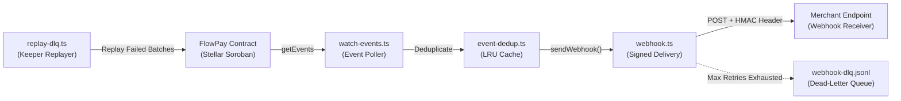

# Webhooks Reference

This document provides a comprehensive guide to webhook payloads, HTTP headers, signature verification, retry backoff, and dead-letter queue (DLQ) replay in PayFlow.

---

## Table of Contents

- [Overview & Architecture](#overview--architecture)
- [HTTP Headers & Delivery Protocol](#http-headers--delivery-protocol)
- [Signature Verification](#signature-verification)
  - [Verification Principles](#verification-principles)
  - [Node.js / TypeScript Example](#nodejs--typescript-example)
  - [Python Example](#python-example)
  - [Go Example](#go-example)
- [Retry Policy & Exponential Backoff](#retry-policy--exponential-backoff)
  - [Transient vs. Permanent Failures](#transient-vs-permanent-failures)
  - [Backoff Schedule](#backoff-schedule)
  - [Rate Limiting (HTTP 429 & Retry-After)](#rate-limiting-http-429--retry-after)
  - [Timeouts & Connection Management](#timeouts--connection-management)
- [Dead-Letter Queue (DLQ) Specifications](#dead-letter-queue-dlq-specifications)
  - [Webhook DLQ Format](#webhook-dlq-format)
  - [Keeper Batch DLQ Format](#keeper-batch-dlq-format)
  - [Redaction & Security](#redaction--security)
- [DLQ Replay Procedures](#dlq-replay-procedures)
  - [Keeper DLQ Replay (`replay-dlq.ts`)](#keeper-dlq-replay-replay-dlqts)
  - [Webhook DLQ Replay Recipe](#webhook-dlq-replay-recipe)
- [Delivered Event Payloads Catalog](#delivered-event-payloads-catalog)
  - [Payload Envelope (`ParsedEvent`)](#payload-envelope-parsedevent)
  - [Subscription Lifecycle Events](#subscription-lifecycle-events)
  - [Charging & Payment Events](#charging--payment-events)
  - [Subscription Configuration Events](#subscription-configuration-events)
  - [Daily Spending Limit Events](#daily-spending-limit-events)
  - [Merchant Management Events](#merchant-management-events)
  - [Protocol & Admin Governance Events](#protocol--admin-governance-events)
  - [Grace Period & Referral Events](#grace-period--referral-events)
  - [Migration & Maintenance Events](#migration--maintenance-events)
  - [Operational Alert Webhook Payloads](#operational-alert-webhook-payloads)
- [Environment Configuration](#environment-configuration)
- [Best Practices](#best-practices)
- [Related Documentation](#related-documentation)

---

## Overview & Architecture

PayFlow smart contracts execute on Stellar Soroban. Because blockchains do not push HTTP webhooks directly, PayFlow employs an event-driven off-chain forwarding architecture:

1. **On-Chain Emission**: The FlowPay smart contract publishes typed events (`contract/src/events.rs`) for state transitions such as subscriptions, recurring charges, micro-payments, and cancellations.
2. **Monitoring & Deduplication**: The event listener (`scripts/watch-events.ts`) continuously polls the Soroban RPC endpoint `getEvents`. It filters out duplicates via an in-memory LRU deduplication cache (`scripts/event-dedup.ts`).
3. **Signed Forwarding**: Valid events are serialized to JSON and delivered via HTTP POST to the merchant's configured endpoint (`WEBHOOK_URL`) using HMAC-SHA256 signing (`scripts/webhook.ts`).
4. **Resilience & DLQ**: Deliveries that fail transient network or server errors are retried with exponential backoff. Payloads that exhaust all retries are recorded in a Dead-Letter Queue (JSON Lines file) for safe storage and subsequent replay.
5. **Operational Alerts**: Specialized batch monitoring jobs (`scripts/alert-failed-charges.ts`, `scripts/alert-expiring-allowances.ts`, `scripts/daily-revenue-summary.ts`) push summary alert webhooks to notify merchants of billing issues.



---

## HTTP Headers & Delivery Protocol

All webhook deliveries are issued via HTTP `POST` requests. Receivers should acknowledge receipt with an HTTP `2xx` response (such as `200 OK` or `204 No Content`) within the configured timeout window (default: 10 seconds).

### Request Headers

| Header | Description | Example |
| --- | --- | --- |
| `Content-Type` | Payload serialization format. Always JSON. | `application/json` |
| `X-PayFlow-Signature` | Hex-encoded HMAC-SHA256 signature calculated over the exact raw body bytes with `WEBHOOK_SECRET`. (Sent by `sendWebhook` in `watch-events.ts`). | `8f591c28c6883b28b7fa4360e7b752df242ac0c87ad620021ae6ae82626e2e50` |
| `X-Signature-SHA256` | Hex-encoded HMAC-SHA256 signature prefixed with `sha256=`. (Sent by `deliverWebhook` in `webhook.ts`). | `sha256=8f591c28c6883b28b7fa4360e7b752df242ac0c87ad620021ae6ae82626e2e50` |
| `Connection` | Socket connection persistence directive. | `close` |
| `User-Agent` | Client runtime identifier. | `node-fetch/1.0` or `undici` |

> [!IMPORTANT]
> The HMAC signature is computed against the **raw unparsed UTF-8 request body bytes**. Do not parse or re-serialize the JSON before verifying the signature, as variations in whitespace or key ordering will invalidate the signature.

---

## Signature Verification

### Verification Principles

1. **Shared Secret**: Both the sender and receiver share a secret key (`WEBHOOK_SECRET`). Keep this secret confidential and never expose it in logs or client-side bundles.
2. **Raw Body**: Compute the HMAC-SHA256 hash using the raw HTTP request body string/buffer before JSON decoding.
3. **Timing-Safe Comparison**: Always use a constant-time comparison utility (such as `timingSafeEqual` in Node.js or `hmac.compare_digest` in Python) to prevent timing-attack vulnerabilities.
4. **Header Compatibility**: Support checking both raw 64-character hex strings (`X-PayFlow-Signature`) and prefixed strings (`X-Signature-SHA256: sha256=<hex>`).

### Node.js / TypeScript Example

```typescript
import { createHmac, timingSafeEqual } from "node:crypto";
import type { IncomingMessage, ServerResponse } from "node:http";

/**
 * Validates a PayFlow webhook signature against the raw request body.
 *
 * @param rawBody - Raw body buffer or string received from the socket.
 * @param secret - Shared secret configured in WEBHOOK_SECRET.
 * @param signatureHeader - Value of X-PayFlow-Signature or X-Signature-SHA256.
 * @returns true if valid, false otherwise.
 */
export function verifyWebhookSignature(
  rawBody: string | Buffer,
  secret: string,
  signatureHeader?: string | null
): boolean {
  if (!rawBody || !secret || !signatureHeader) {
    return false;
  }

  // Strip optional 'sha256=' prefix if present
  const receivedHex = signatureHeader.startsWith("sha256=")
    ? signatureHeader.slice(7)
    : signatureHeader;

  // SHA256 hex digest must be exactly 64 characters
  if (receivedHex.length !== 64) {
    return false;
  }

  const computedHex = createHmac("sha256", secret)
    .update(rawBody)
    .digest("hex");

  const expectedBuf = Buffer.from(computedHex, "utf8");
  const receivedBuf = Buffer.from(receivedHex, "utf8");

  if (expectedBuf.length !== receivedBuf.length) {
    return false;
  }

  return timingSafeEqual(expectedBuf, receivedBuf);
}

// Express / Connect middleware example:
export function payflowWebhookMiddleware(secret: string) {
  return (req: any, res: any, next: any) => {
    // Requires express.raw({ type: 'application/json' })
    const rawBody = req.body;
    const signature =
      req.headers["x-payflow-signature"] ||
      req.headers["x-signature-sha256"];

    if (!verifyWebhookSignature(rawBody, secret, signature)) {
      return res.status(401).json({ error: "Invalid webhook signature" });
    }

    req.parsedEvent = JSON.parse(rawBody.toString("utf8"));
    next();
  };
}
```

### Python Example

```python
import hmac
import hashlib
from typing import Optional

def verify_webhook_signature(
    raw_body: bytes,
    secret: str,
    signature_header: Optional[str]
) -> bool:
    """
    Validates a PayFlow webhook signature in Python.
    
    :param raw_body: Raw request body as bytes.
    :param secret: WEBHOOK_SECRET shared key.
    :param signature_header: Contents of X-PayFlow-Signature or X-Signature-SHA256.
    :return: True if the signature matches, False otherwise.
    """
    if not raw_body or not secret or not signature_header:
        return False

    received_hex = signature_header
    if received_hex.startswith("sha256="):
        received_hex = received_hex[7:]

    if len(received_hex) != 64:
        return False

    computed_hex = hmac.new(
        key=secret.encode("utf-8"),
        msg=raw_body,
        digestmod=hashlib.sha256
    ).hexdigest()

    return hmac.compare_digest(computed_hex, received_hex)
```

### Go Example

```go
package main

import (
	"crypto/hmac"
	"crypto/sha256"
	"encoding/hex"
	"strings"
)

// VerifyWebhookSignature verifies the HMAC-SHA256 signature for PayFlow webhooks.
func VerifyWebhookSignature(rawBody []byte, secret string, signatureHeader string) bool {
	if len(rawBody) == 0 || secret == "" || signatureHeader == "" {
		return false
	}

	receivedHex := signatureHeader
	if strings.HasPrefix(receivedHex, "sha256=") {
		receivedHex = strings.TrimPrefix(receivedHex, "sha256=")
	}

	receivedSig, err := hex.DecodeString(receivedHex)
	if err != nil || len(receivedSig) != 32 {
		return false
	}

	mac := hmac.New(sha256.New, []byte(secret))
	mac.Write(rawBody)
	expectedSig := mac.Sum(nil)

	return hmac.Equal(expectedSig, receivedSig)
}
```

---

## Retry Policy & Exponential Backoff

PayFlow incorporates delivery retries in `scripts/webhook.ts` to ensure delivery resilience during transient network faults or receiver maintenance.

### Transient vs. Permanent Failures

The delivery mechanism classifies HTTP and transport errors into two categories:

- **Transient Errors (Retried)**:
  - Network timeouts (AbortError / ETIMEDOUT).
  - DNS resolution failures or connection refused (ECONNREFUSED / ENOTFOUND).
  - HTTP `408 Request Timeout`.
  - HTTP `429 Too Many Requests`.
  - HTTP `5xx` Server Errors (`500`, `502`, `503`, `504`).
- **Permanent Errors (Not Retried)**:
  - HTTP `4xx` Client Errors (`400 Bad Request`, `401 Unauthorized`, `403 Forbidden`, `404 Not Found`, `422 Unprocessable Entity`).
  - These failures terminate immediately without exhausting further retries. The failed payload is written directly to the DLQ.

### Backoff Schedule

When a transient error occurs, subsequent delivery attempts are delayed with exponential backoff:

$$\text{delay} = \min\left(1000 \times 2^{\text{attempt} - 1},\, 30000\right)\text{ ms}$$

| Attempt | Base Delay | Cumulative Elapsed Time |
| --- | --- | --- |
| 1 | Immediate | 0s |
| 2 | 1,000 ms (1s) | ~1s |
| 3 | 2,000 ms (2s) | ~3s |
| 4 | 4,000 ms (4s) | ~7s |
| 5 | 8,000 ms (8s) | ~15s |
| 6 (Final) | 16,000 ms (16s) | ~31s |

The maximum number of retries is configurable via `MAX_RETRIES` or `WebhookConfig.maxRetries` (default: 5 retries = 6 attempts total in `sendWebhook`; 3 retries in `deliverWebhook`).

### Rate Limiting (HTTP 429 & Retry-After)

If the receiving server responds with `HTTP 429 Too Many Requests` along with a `Retry-After` header:

```http
HTTP/1.1 429 Too Many Requests
Retry-After: 10
```

`sendWebhook` parses the `Retry-After` integer (in seconds) and waits for the requested duration instead of the default backoff calculation, capped at a maximum of 30 seconds.

### Timeouts & Connection Management

- **Request Timeout**: Each attempt is bounded by an `AbortController` timeout (default: 10,000 ms, configurable via `WEBHOOK_TIMEOUT`).
- **Timer Leak Protection**: Timers are cleared in guaranteed `finally` blocks via `fetchWithTimeout` to prevent process leaks during network connection failures.
- **Connection Header**: Requests include `Connection: close` to prevent idle socket pooling issues during long-running event monitoring.

---

## Dead-Letter Queue (DLQ) Specifications

When a webhook payload fails permanently (e.g. HTTP 4xx) or exhausts all retry attempts, it is appended to a local Dead-Letter Queue file.

### Webhook DLQ Format

The webhook DLQ is stored as a JSON Lines (NDJSON) file at `data/webhook-dlq.jsonl` (or configured via `WEBHOOK_DLQ_FILE` / `DLQ_PATH`). Each line represents a single failed delivery:

```json
{
  "timestamp": "2026-11-19T17:15:00.123Z",
  "destination": "https://api.merchant.com/webhooks/payflow",
  "error": "HTTP 500",
  "attempts": 6,
  "payload": {
    "id": "12345:a1b2c3d4e5f6...:charged:GABC123...",
    "type": "charged",
    "user": "GABC1234567890ABCDEFGHIJKLMNOPQRSTUVWXYZ",
    "merchant": "GDEF1234567890ABCDEFGHIJKLMNOPQRSTUVWXYZ",
    "amount": "50000000",
    "timestamp": 1700000000,
    "ledger": 12345,
    "txHash": "a1b2c3d4e5f6..."
  }
}
```

#### Webhook DLQ Field Schema

| Field | Type | Description |
| --- | --- | --- |
| `timestamp` | `string` | ISO 8601 UTC timestamp when the failure occurred. |
| `destination` | `string` | Target webhook URL (secrets are never included). |
| `error` | `string` | Final error message or HTTP status code recorded. |
| `attempts` | `number` | Total number of delivery attempts made before exhaustion. |
| `payload` | `object` | Original unmutated event payload that failed to deliver. |

### Keeper Batch DLQ Format

In addition to webhooks, the automated keeper service (`scripts/keeper.ts`) records on-chain transaction failures into `dlq/failed-batches.jsonl`:

```json
{
  "timestamp": "2026-11-19T17:15:00.000Z",
  "offset": 0,
  "limit": 50,
  "users": [
    "GABC1234567890ABCDEFGHIJKLMNOPQRSTUVWXYZ",
    "GXYZ9876543210ZYXWVUTSRQPONMLKJIHGFEDCBA"
  ],
  "error": "Simulation failed: HostError",
  "tx_xdr": null,
  "attempts": 3,
  "ledger": 12345
}
```

### Redaction & Security

- **Secrets Never Stored**: Neither `WEBHOOK_SECRET` nor `KEEPER_SECRET` is ever logged or written to DLQ files.
- **Log Scrubbing**: All logging through `scripts/logger.ts` runs messages through `redactSecrets`, ensuring Stellar private keys (`S...`) and webhook secrets are redacted.

---

## DLQ Replay Procedures

### Keeper DLQ Replay (`replay-dlq.ts`)

`scripts/replay-dlq.ts` retries failed on-chain batches from `dlq/failed-batches.jsonl`.

#### Workflow

1. Reads entries from `dlq/failed-batches.jsonl`.
2. Inspects `error` strings against `PERMANENT_ERROR_PATTERNS` (`NoSubscriptionFound`, `SubscriptionInactive`, `ContractPaused`, `ContractPausedError`, `Unauthorized`). Permanent failures are moved directly to `dlq/dead-batches.jsonl`.
3. Runs an off-chain precheck (`isChargeDue(user)`) to avoid spending gas on accounts that are no longer due.
4. Simulates and submits a `batch_charge` transaction to the contract with exponential backoff.
5. Successful entries are appended to `dlq/replayed-batches.jsonl`.
6. Entries that still fail after maximum retries are appended to `dlq/dead-batches.jsonl`.
7. The input file `dlq/failed-batches.jsonl` is rewritten to contain only unresolved rows.

#### Running `replay-dlq.ts`

```bash
# 1. Dry run: inspect entries without submitting any transactions
CONTRACT_ID=C... KEEPER_SECRET=S... npx tsx scripts/replay-dlq.ts --dry-run

# 2. Live execution
CONTRACT_ID=C... KEEPER_SECRET=S... npx tsx scripts/replay-dlq.ts

# 3. Custom DLQ file and retry configuration
CONTRACT_ID=C... KEEPER_SECRET=S... \
  DLQ_FILE=custom-dlq.jsonl \
  KEEPER_MAX_RETRIES=5 \
  KEEPER_RETRY_BASE_MS=2000 \
  npx tsx scripts/replay-dlq.ts
```

### Webhook DLQ Replay Recipe

When a merchant endpoint recovers after an outage, failed webhook payloads recorded in `data/webhook-dlq.jsonl` can be re-delivered.

#### Automated Replay Script Pattern

```typescript
import { readFileSync, writeFileSync } from "node:fs";
import { sendWebhook, WebhookConfig } from "./scripts/webhook.js";

async function replayWebhookDlq(dlqPath: string, config: WebhookConfig) {
  const content = readFileSync(dlqPath, "utf-8").trim();
  if (!content) {
    console.log("DLQ is empty.");
    return;
  }

  const lines = content.split("\n");
  const failedAgain: string[] = [];

  for (const line of lines) {
    const entry = JSON.parse(line);
    console.log(`Replaying event ${entry.payload?.id || "unknown"}...`);

    try {
      await sendWebhook(entry.payload, config);
      console.log(`✓ Replayed successfully`);
    } catch (err) {
      console.error(`✗ Replay failed: ${err}`);
      failedAgain.push(line);
    }
  }

  // Update DLQ with remaining failures
  writeFileSync(dlqPath, failedAgain.join("\n") + (failedAgain.length ? "\n" : ""));
}
```

---

## Delivered Event Payloads Catalog

### Payload Envelope (`ParsedEvent`)

The standard event forwarding listener `scripts/watch-events.ts` normalizes on-chain events into the `ParsedEvent` JSON envelope delivered to the webhook endpoint:

```typescript
interface ParsedEvent {
  id: string;          // Formatted as "${ledger}:${txHash}:${eventType}:${user}"
  type: string;        // Event topic name (e.g. "charged", "subscribed")
  user: string;        // Subscriber or target Stellar account address (G...)
  merchant?: string;   // Merchant Stellar address (G...)
  amount?: string;     // Amount in stroops (1 XLM = 10,000,000 stroops)
  timestamp: number;   // Ledger close timestamp in Unix seconds
  ledger: number;      // Stellar ledger sequence number
  txHash: string;      // Stellar transaction hash
}
```

---

### Subscription Lifecycle Events

#### 1. `subscribed`
Emitted when a subscriber starts a recurring subscription.

```json
{
  "id": "12345:9e2b1a8d0f...:subscribed:GABC1234567890ABCDEFGHIJKLMNOPQRSTUVWXYZ",
  "type": "subscribed",
  "user": "GABC1234567890ABCDEFGHIJKLMNOPQRSTUVWXYZ",
  "merchant": "GDEF1234567890ABCDEFGHIJKLMNOPQRSTUVWXYZ",
  "amount": "50000000",
  "timestamp": 1700000000,
  "ledger": 12345,
  "txHash": "9e2b1a8d0f1c2b3a4e5d6f7a8b9c0d1e2f3a4b5c6d7e8f9a0b1c2d3e4f5a6b7c"
}
```

*Raw Contract Value*: `{ "merchant": "GDEF...", "amount": 50000000, "interval": 2592000, "ledger_sequence": 12345 }`

#### 2. `paused`
Emitted when a user or administrator indefinitely pauses an active subscription.

```json
{
  "id": "12346:7a8b9c0d1e...:paused:GABC1234567890ABCDEFGHIJKLMNOPQRSTUVWXYZ",
  "type": "paused",
  "user": "GABC1234567890ABCDEFGHIJKLMNOPQRSTUVWXYZ",
  "timestamp": 1700000030,
  "ledger": 12346,
  "txHash": "7a8b9c0d1e2f3a4b5c6d7e8f9a0b1c2d3e4f5a6b7c8d9e0f1a2b3c4d5e6f7a8b"
}
```

*Raw Contract Value*: `()`

#### 3. `pause_until`
Emitted when a subscription is paused temporarily with an automatic resumption timestamp.

```json
{
  "id": "12347:1c2b3a4e5d...:pause_until:GABC1234567890ABCDEFGHIJKLMNOPQRSTUVWXYZ",
  "type": "pause_until",
  "user": "GABC1234567890ABCDEFGHIJKLMNOPQRSTUVWXYZ",
  "timestamp": 1700000060,
  "ledger": 12347,
  "txHash": "1c2b3a4e5d6f7a8b9c0d1e2f3a4b5c6d7e8f9a0b1c2d3e4f5a6b7c8d9e0f1a2b"
}
```

*Raw Contract Value*: `{ "expiry_timestamp": 1720000000, "ledger_sequence": 12347 }`

#### 4. `resumed`
Emitted when a paused subscription is resumed.

```json
{
  "id": "12348:3a4b5c6d7e...:resumed:GABC1234567890ABCDEFGHIJKLMNOPQRSTUVWXYZ",
  "type": "resumed",
  "user": "GABC1234567890ABCDEFGHIJKLMNOPQRSTUVWXYZ",
  "timestamp": 1700000090,
  "ledger": 12348,
  "txHash": "3a4b5c6d7e8f9a0b1c2d3e4f5a6b7c8d9e0f1a2b3c4d5e6f7a8b9c0d1e2f3a4b"
}
```

*Raw Contract Value*: `()`

#### 5. `cancelled`
Emitted when a subscription is deactivated without refund.

```json
{
  "id": "12349:5c6d7e8f9a...:cancelled:GABC1234567890ABCDEFGHIJKLMNOPQRSTUVWXYZ",
  "type": "cancelled",
  "user": "GABC1234567890ABCDEFGHIJKLMNOPQRSTUVWXYZ",
  "timestamp": 1700000120,
  "ledger": 12349,
  "txHash": "5c6d7e8f9a0b1c2d3e4f5a6b7c8d9e0f1a2b3c4d5e6f7a8b9c0d1e2f3a4b5c6d"
}
```

*Raw Contract Value*: `{ "ledger_sequence": 12349 }`

#### 6. `cancelled_with_refund`
Emitted when a subscription is cancelled and receives a prorated refund.

```json
{
  "id": "12350:6d7e8f9a0b...:cancelled_with_refund:GABC1234567890ABCDEFGHIJKLMNOPQRSTUVWXYZ",
  "type": "cancelled_with_refund",
  "user": "GABC1234567890ABCDEFGHIJKLMNOPQRSTUVWXYZ",
  "amount": "25000000",
  "timestamp": 1700000150,
  "ledger": 12350,
  "txHash": "6d7e8f9a0b1c2d3e4f5a6b7c8d9e0f1a2b3c4d5e6f7a8b9c0d1e2f3a4b5c6d7e"
}
```

*Raw Contract Value*: `{ "refund_amount": 25000000, "ledger_sequence": 12350 }`

#### 7. `subscription_transferred`
Emitted when a subscription is transferred from one user address to another.

```json
{
  "id": "12351:7e8f9a0b1c...:subscription_transferred:GABC1234567890ABCDEFGHIJKLMNOPQRSTUVWXYZ",
  "type": "subscription_transferred",
  "user": "GABC1234567890ABCDEFGHIJKLMNOPQRSTUVWXYZ",
  "timestamp": 1700000180,
  "ledger": 12351,
  "txHash": "7e8f9a0b1c2d3e4f5a6b7c8d9e0f1a2b3c4d5e6f7a8b9c0d1e2f3a4b5c6d7e8f"
}
```

*Raw Contract Value*: `{ "new_user": "GXYZ9876543210ZYXWVUTSRQPONMLKJIHGFEDCBA", "ledger_sequence": 12351 }`

---

### Charging & Payment Events

#### 8. `charged`
Emitted when a scheduled recurring billing cycle successfully charges a subscriber.

```json
{
  "id": "12352:8f9a0b1c2d...:charged:GABC1234567890ABCDEFGHIJKLMNOPQRSTUVWXYZ",
  "type": "charged",
  "user": "GABC1234567890ABCDEFGHIJKLMNOPQRSTUVWXYZ",
  "merchant": "GDEF1234567890ABCDEFGHIJKLMNOPQRSTUVWXYZ",
  "amount": "50000000",
  "timestamp": 1700000210,
  "ledger": 12352,
  "txHash": "8f9a0b1c2d3e4f5a6b7c8d9e0f1a2b3c4d5e6f7a8b9c0d1e2f3a4b5c6d7e8f9a"
}
```

*Raw Contract Value*:
```json
{
  "merchant": "GDEF1234567890ABCDEFGHIJKLMNOPQRSTUVWXYZ",
  "gross": 50000000,
  "fee": 500000,
  "net": 49500000,
  "charged_at": 1700000210,
  "ledger_sequence": 12352,
  "paid_to": "GFEE1234567890ABCDEFGHIJKLMNOPQRSTUVWXYZ"
}
```

#### 9. `pay_per_use`
Emitted when a subscriber initiates an instantaneous off-cycle microtransaction.

```json
{
  "id": "12353:9a0b1c2d3e...:pay_per_use:GABC1234567890ABCDEFGHIJKLMNOPQRSTUVWXYZ",
  "type": "pay_per_use",
  "user": "GABC1234567890ABCDEFGHIJKLMNOPQRSTUVWXYZ",
  "merchant": "GDEF1234567890ABCDEFGHIJKLMNOPQRSTUVWXYZ",
  "amount": "1500000",
  "timestamp": 1700000240,
  "ledger": 12353,
  "txHash": "9a0b1c2d3e4f5a6b7c8d9e0f1a2b3c4d5e6f7a8b9c0d1e2f3a4b5c6d7e8f9a0b"
}
```

*Raw Contract Value*: `{ "merchant": "GDEF...", "amount": 1500000, "ledger_sequence": 12353 }`

#### 10. `batch_charge_skips`
Emitted by the contract during `batch_charge` to report non-charged addresses in the batch.

```json
{
  "id": "12354:0b1c2d3e4f...:batch_charge_skips:",
  "type": "batch_charge_skips",
  "user": "",
  "timestamp": 1700000270,
  "ledger": 12354,
  "txHash": "0b1c2d3e4f5a6b7c8d9e0f1a2b3c4d5e6f7a8b9c0d1e2f3a4b5c6d7e8f9a0b1c"
}
```

*Raw Contract Value*:
```json
{
  "total": 50,
  "charged": 42,
  "not_due": 3,
  "no_subscription": 1,
  "inactive": 1,
  "paused": 1,
  "grace_elapsed": 0,
  "allowance_insufficient": 2,
  "ledger_sequence": 12354
}
```

#### 11. `merchant_withdrawal`
Emitted when a merchant withdraws accumulated revenue from the contract.

```json
{
  "id": "12355:1c2d3e4f5a...:merchant_withdrawal:GDEF1234567890ABCDEFGHIJKLMNOPQRSTUVWXYZ",
  "type": "merchant_withdrawal",
  "user": "GDEF1234567890ABCDEFGHIJKLMNOPQRSTUVWXYZ",
  "amount": "250000000",
  "timestamp": 1700000300,
  "ledger": 12355,
  "txHash": "1c2d3e4f5a6b7c8d9e0f1a2b3c4d5e6f7a8b9c0d1e2f3a4b5c6d7e8f9a0b1c2d"
}
```

*Raw Contract Value*: `{ "amount": 250000000, "ledger_sequence": 12355 }`

---

### Subscription Configuration Events

#### 12. `sub_amount_updated`
Emitted when the billing amount of a subscription is adjusted.

```json
{
  "id": "12356:2d3e4f5a6b...:sub_amount_updated:GABC1234567890ABCDEFGHIJKLMNOPQRSTUVWXYZ",
  "type": "sub_amount_updated",
  "user": "GABC1234567890ABCDEFGHIJKLMNOPQRSTUVWXYZ",
  "amount": "75000000",
  "timestamp": 1700000330,
  "ledger": 12356,
  "txHash": "2d3e4f5a6b7c8d9e0f1a2b3c4d5e6f7a8b9c0d1e2f3a4b5c6d7e8f9a0b1c2d3e"
}
```

*Raw Contract Value*: `{ "old_amount": 50000000, "new_amount": 75000000, "ledger_sequence": 12356 }`

#### 13. `sub_interval_updated`
Emitted when the billing interval (in seconds) of a subscription changes.

```json
{
  "id": "12357:3e4f5a6b7c...:sub_interval_updated:GABC1234567890ABCDEFGHIJKLMNOPQRSTUVWXYZ",
  "type": "sub_interval_updated",
  "user": "GABC1234567890ABCDEFGHIJKLMNOPQRSTUVWXYZ",
  "timestamp": 1700000360,
  "ledger": 12357,
  "txHash": "3e4f5a6b7c8d9e0f1a2b3c4d5e6f7a8b9c0d1e2f3a4b5c6d7e8f9a0b1c2d3e4f"
}
```

*Raw Contract Value*: `{ "old_interval": 2592000, "new_interval": 604800, "ledger_sequence": 12357 }`

#### 14. `trial_extended`
Emitted when a subscriber's free-trial period is extended.

```json
{
  "id": "12358:4f5a6b7c8d...:trial_extended:GABC1234567890ABCDEFGHIJKLMNOPQRSTUVWXYZ",
  "type": "trial_extended",
  "user": "GABC1234567890ABCDEFGHIJKLMNOPQRSTUVWXYZ",
  "timestamp": 1700000390,
  "ledger": 12358,
  "txHash": "4f5a6b7c8d9e0f1a2b3c4d5e6f7a8b9c0d1e2f3a4b5c6d7e8f9a0b1c2d3e4f5a"
}
```

*Raw Contract Value*: `{ "additional_seconds": 604800, "new_trial_end": 1700604800, "ledger_sequence": 12358 }`

#### 15. `metadata_set`
Emitted when custom key/value metadata is attached to a subscription.

```json
{
  "id": "12359:5a6b7c8d9e...:metadata_set:GABC1234567890ABCDEFGHIJKLMNOPQRSTUVWXYZ",
  "type": "metadata_set",
  "user": "GABC1234567890ABCDEFGHIJKLMNOPQRSTUVWXYZ",
  "timestamp": 1700000420,
  "ledger": 12359,
  "txHash": "5a6b7c8d9e0f1a2b3c4d5e6f7a8b9c0d1e2f3a4b5c6d7e8f9a0b1c2d3e4f5a6b"
}
```

*Raw Contract Value*: `{ "label": "tier:pro", "ledger_sequence": 12359 }`

#### 16. `metadata_cleared`
Emitted when metadata is cleared from a subscription.

```json
{
  "id": "12360:6b7c8d9e0f...:metadata_cleared:GABC1234567890ABCDEFGHIJKLMNOPQRSTUVWXYZ",
  "type": "metadata_cleared",
  "user": "GABC1234567890ABCDEFGHIJKLMNOPQRSTUVWXYZ",
  "timestamp": 1700000450,
  "ledger": 12360,
  "txHash": "6b7c8d9e0f1a2b3c4d5e6f7a8b9c0d1e2f3a4b5c6d7e8f9a0b1c2d3e4f5a6b7c"
}
```

*Raw Contract Value*: `{ "ledger_sequence": 12360 }`

---

### Daily Spending Limit Events

#### 17. `daily_limit_set`
Emitted when a subscriber enforces a daily spending ceiling.

```json
{
  "id": "12361:7c8d9e0f1a...:daily_limit_set:GABC1234567890ABCDEFGHIJKLMNOPQRSTUVWXYZ",
  "type": "daily_limit_set",
  "user": "GABC1234567890ABCDEFGHIJKLMNOPQRSTUVWXYZ",
  "amount": "100000000",
  "timestamp": 1700000480,
  "ledger": 12361,
  "txHash": "7c8d9e0f1a2b3c4d5e6f7a8b9c0d1e2f3a4b5c6d7e8f9a0b1c2d3e4f5a6b7c8d"
}
```

*Raw Contract Value*: `{ "limit": 100000000, "ledger_sequence": 12361 }`

#### 18. `daily_limit_removed`
Emitted when a subscriber clears their daily spending limit.

```json
{
  "id": "12362:8d9e0f1a2b...:daily_limit_removed:GABC1234567890ABCDEFGHIJKLMNOPQRSTUVWXYZ",
  "type": "daily_limit_removed",
  "user": "GABC1234567890ABCDEFGHIJKLMNOPQRSTUVWXYZ",
  "timestamp": 1700000510,
  "ledger": 12362,
  "txHash": "8d9e0f1a2b3c4d5e6f7a8b9c0d1e2f3a4b5c6d7e8f9a0b1c2d3e4f5a6b7c8d9e"
}
```

*Raw Contract Value*: `{ "ledger_sequence": 12362 }`

#### 19. `daily_window_started`
Emitted when a subscriber's rolling 24-hour spending window initializes.

```json
{
  "id": "12363:9e0f1a2b3c...:daily_window_started:GABC1234567890ABCDEFGHIJKLMNOPQRSTUVWXYZ",
  "type": "daily_window_started",
  "user": "GABC1234567890ABCDEFGHIJKLMNOPQRSTUVWXYZ",
  "timestamp": 1700000540,
  "ledger": 12363,
  "txHash": "9e0f1a2b3c4d5e6f7a8b9c0d1e2f3a4b5c6d7e8f9a0b1c2d3e4f5a6b7c8d9e0f"
}
```

*Raw Contract Value*: `{ "ledger_sequence": 12363 }`

---

### Merchant Management Events

#### 20. `merchant_added`
Emitted when a new merchant is approved or onboarded.

```json
{
  "id": "12364:0f1a2b3c4d...:merchant_added:GDEF1234567890ABCDEFGHIJKLMNOPQRSTUVWXYZ",
  "type": "merchant_added",
  "user": "GDEF1234567890ABCDEFGHIJKLMNOPQRSTUVWXYZ",
  "timestamp": 1700000570,
  "ledger": 12364,
  "txHash": "0f1a2b3c4d5e6f7a8b9c0d1e2f3a4b5c6d7e8f9a0b1c2d3e4f5a6b7c8d9e0f1a"
}
```

*Raw Contract Value*: `{ "ledger_sequence": 12364 }`

#### 21. `merchant_removed`
Emitted when a merchant is removed from the active registry.

```json
{
  "id": "12365:1a2b3c4d5e...:merchant_removed:GDEF1234567890ABCDEFGHIJKLMNOPQRSTUVWXYZ",
  "type": "merchant_removed",
  "user": "GDEF1234567890ABCDEFGHIJKLMNOPQRSTUVWXYZ",
  "timestamp": 1700000600,
  "ledger": 12365,
  "txHash": "1a2b3c4d5e6f7a8b9c0d1e2f3a4b5c6d7e8f9a0b1c2d3e4f5a6b7c8d9e0f1a2b"
}
```

*Raw Contract Value*: `{ "ledger_sequence": 12365 }`

#### 22. `merchant_frozen`
Emitted when a merchant's operations are temporarily suspended.

```json
{
  "id": "12366:2b3c4d5e6f...:merchant_frozen:GDEF1234567890ABCDEFGHIJKLMNOPQRSTUVWXYZ",
  "type": "merchant_frozen",
  "user": "GDEF1234567890ABCDEFGHIJKLMNOPQRSTUVWXYZ",
  "timestamp": 1700000630,
  "ledger": 12366,
  "txHash": "2b3c4d5e6f7a8b9c0d1e2f3a4b5c6d7e8f9a0b1c2d3e4f5a6b7c8d9e0f1a2b3c"
}
```

*Raw Contract Value*: `{ "ledger_sequence": 12366 }`

#### 23. `merchant_unfrozen`
Emitted when a frozen merchant is reinstated.

```json
{
  "id": "12367:3c4d5e6f7a...:merchant_unfrozen:GDEF1234567890ABCDEFGHIJKLMNOPQRSTUVWXYZ",
  "type": "merchant_unfrozen",
  "user": "GDEF1234567890ABCDEFGHIJKLMNOPQRSTUVWXYZ",
  "timestamp": 1700000660,
  "ledger": 12367,
  "txHash": "3c4d5e6f7a8b9c0d1e2f3a4b5c6d7e8f9a0b1c2d3e4f5a6b7c8d9e0f1a2b3c4d"
}
```

*Raw Contract Value*: `{ "ledger_sequence": 12367 }`

#### 24. `merchant_fee_recipient_set`
Emitted when a merchant configures a dedicated wallet for revenue/fees.

```json
{
  "id": "12368:4d5e6f7a8b...:merchant_fee_recipient_set:GDEF1234567890ABCDEFGHIJKLMNOPQRSTUVWXYZ",
  "type": "merchant_fee_recipient_set",
  "user": "GDEF1234567890ABCDEFGHIJKLMNOPQRSTUVWXYZ",
  "timestamp": 1700000690,
  "ledger": 12368,
  "txHash": "4d5e6f7a8b9c0d1e2f3a4b5c6d7e8f9a0b1c2d3e4f5a6b7c8d9e0f1a2b3c4d5e"
}
```

*Raw Contract Value*: `{ "recipient": "GFEE1234567890ABCDEFGHIJKLMNOPQRSTUVWXYZ", "ledger_sequence": 12368 }`

#### 25. `merchant_fee_recipient_cleared`
Emitted when a merchant fee recipient is cleared.

```json
{
  "id": "12369:5e6f7a8b9c...:merchant_fee_recipient_cleared:GDEF1234567890ABCDEFGHIJKLMNOPQRSTUVWXYZ",
  "type": "merchant_fee_recipient_cleared",
  "user": "GDEF1234567890ABCDEFGHIJKLMNOPQRSTUVWXYZ",
  "timestamp": 1700000720,
  "ledger": 12369,
  "txHash": "5e6f7a8b9c0d1e2f3a4b5c6d7e8f9a0b1c2d3e4f5a6b7c8d9e0f1a2b3c4d5e6f"
}
```

*Raw Contract Value*: `{ "ledger_sequence": 12369 }`

#### 26. `merchant_revenue_reset`
Emitted when merchant lifetime tracked revenue counter is reset.

```json
{
  "id": "12370:6f7a8b9c0d...:merchant_revenue_reset:GDEF1234567890ABCDEFGHIJKLMNOPQRSTUVWXYZ",
  "type": "merchant_revenue_reset",
  "user": "GDEF1234567890ABCDEFGHIJKLMNOPQRSTUVWXYZ",
  "timestamp": 1700000750,
  "ledger": 12370,
  "txHash": "6f7a8b9c0d1e2f3a4b5c6d7e8f9a0b1c2d3e4f5a6b7c8d9e0f1a2b3c4d5e6f7a"
}
```

*Raw Contract Value*: `{ "ledger_sequence": 12370 }`

#### 27. `merchant_revenue_pruned`
Emitted when stale daily revenue history records are pruned.

```json
{
  "id": "12371:7a8b9c0d1e...:merchant_revenue_pruned:GDEF1234567890ABCDEFGHIJKLMNOPQRSTUVWXYZ",
  "type": "merchant_revenue_pruned",
  "user": "GDEF1234567890ABCDEFGHIJKLMNOPQRSTUVWXYZ",
  "timestamp": 1700000780,
  "ledger": 12371,
  "txHash": "7a8b9c0d1e2f3a4b5c6d7e8f9a0b1c2d3e4f5a6b7c8d9e0f1a2b3c4d5e6f7a8b"
}
```

*Raw Contract Value*: `{ "removed_days": 14, "ledger_sequence": 12371 }`

#### 28. `merch_hist_cleared`
Emitted when all historical revenue records for a merchant are purged.

```json
{
  "id": "12372:8b9c0d1e2f...:merch_hist_cleared:GDEF1234567890ABCDEFGHIJKLMNOPQRSTUVWXYZ",
  "type": "merch_hist_cleared",
  "user": "GDEF1234567890ABCDEFGHIJKLMNOPQRSTUVWXYZ",
  "timestamp": 1700000810,
  "ledger": 12372,
  "txHash": "8b9c0d1e2f3a4b5c6d7e8f9a0b1c2d3e4f5a6b7c8d9e0f1a2b3c4d5e6f7a8b9c"
}
```

*Raw Contract Value*: `{ "ledger_sequence": 12372 }`

---

### Protocol & Admin Governance Events

#### 29. `contract_paused`
Emitted when the emergency protocol-wide circuit breaker is engaged.

```json
{
  "id": "12373:9c0d1e2f3a...:contract_paused:",
  "type": "contract_paused",
  "user": "",
  "timestamp": 1700000840,
  "ledger": 12373,
  "txHash": "9c0d1e2f3a4b5c6d7e8f9a0b1c2d3e4f5a6b7c8d9e0f1a2b3c4d5e6f7a8b9c0d"
}
```

*Raw Contract Value*: `{ "ledger_sequence": 12373 }`

#### 30. `contract_unpaused`
Emitted when normal contract operations resume after a pause.

```json
{
  "id": "12374:0d1e2f3a4b...:contract_unpaused:",
  "type": "contract_unpaused",
  "user": "",
  "timestamp": 1700000870,
  "ledger": 12374,
  "txHash": "0d1e2f3a4b5c6d7e8f9a0b1c2d3e4f5a6b7c8d9e0f1a2b3c4d5e6f7a8b9c0d1e"
}
```

*Raw Contract Value*: `{ "ledger_sequence": 12374 }`

#### 31. `admin_transfer_proposed`
Emitted during stage 1 of a two-step admin transfer.

```json
{
  "id": "12375:1e2f3a4b5c...:admin_transfer_proposed:GNEW1234567890ABCDEFGHIJKLMNOPQRSTUVWXYZ",
  "type": "admin_transfer_proposed",
  "user": "GNEW1234567890ABCDEFGHIJKLMNOPQRSTUVWXYZ",
  "timestamp": 1700000900,
  "ledger": 12375,
  "txHash": "1e2f3a4b5c6d7e8f9a0b1c2d3e4f5a6b7c8d9e0f1a2b3c4d5e6f7a8b9c0d1e2f"
}
```

*Raw Contract Value*: `{ "new_admin": "GNEW1234567890ABCDEFGHIJKLMNOPQRSTUVWXYZ", "ledger_sequence": 12375 }`

#### 32. `admin_transferred`
Emitted during stage 2 when the pending admin accepts ownership.

```json
{
  "id": "12376:2f3a4b5c6d...:admin_transferred:GNEW1234567890ABCDEFGHIJKLMNOPQRSTUVWXYZ",
  "type": "admin_transferred",
  "user": "GNEW1234567890ABCDEFGHIJKLMNOPQRSTUVWXYZ",
  "timestamp": 1700000930,
  "ledger": 12376,
  "txHash": "2f3a4b5c6d7e8f9a0b1c2d3e4f5a6b7c8d9e0f1a2b3c4d5e6f7a8b9c0d1e2f3a"
}
```

*Raw Contract Value*: `{ "old_admin": "GOLD...", "new_admin": "GNEW...", "ledger_sequence": 12376 }`

#### 33. `fee_bounds_set`
Emitted when governance configures minimum and maximum basis points for protocol fees.

```json
{
  "id": "12377:3a4b5c6d7e...:fee_bounds_set:",
  "type": "fee_bounds_set",
  "user": "",
  "timestamp": 1700000960,
  "ledger": 12377,
  "txHash": "3a4b5c6d7e8f9a0b1c2d3e4f5a6b7c8d9e0f1a2b3c4d5e6f7a8b9c0d1e2f3a4b"
}
```

*Raw Contract Value*: `{ "min_bps": 10, "max_bps": 500, "ledger_sequence": 12377 }`

#### 34. `fee_proposed` & `fee_committed`
Emitted during the two-step protocol fee configuration.

```json
{
  "id": "12378:4b5c6d7e8f...:fee_committed:",
  "type": "fee_committed",
  "user": "",
  "timestamp": 1700000990,
  "ledger": 12378,
  "txHash": "4b5c6d7e8f9a0b1c2d3e4f5a6b7c8d9e0f1a2b3c4d5e6f7a8b9c0d1e2f3a4b5c"
}
```

*Raw Contract Value*: `{ "collector": "GFEE...", "bps": 50, "ledger_sequence": 12378 }`

#### 35. `global_volume_cap_set`
Emitted when a global volume limit is placed on contract settlements.

```json
{
  "id": "12379:5c6d7e8f9a...:global_volume_cap_set:",
  "type": "global_volume_cap_set",
  "user": "",
  "amount": "1000000000000",
  "timestamp": 1700001020,
  "ledger": 12379,
  "txHash": "5c6d7e8f9a0b1c2d3e4f5a6b7c8d9e0f1a2b3c4d5e6f7a8b9c0d1e2f3a4b5c6d"
}
```

*Raw Contract Value*: `{ "old": 500000000000, "new": 1000000000000, "ledger_sequence": 12379 }`

#### 36. `max_batch_size_set` & `max_wl_batch_size_set`
Emitted when keeper batch execution size limits are updated.

```json
{
  "id": "12380:6d7e8f9a0b...:max_batch_size_set:",
  "type": "max_batch_size_set",
  "user": "",
  "timestamp": 1700001050,
  "ledger": 12380,
  "txHash": "6d7e8f9a0b1c2d3e4f5a6b7c8d9e0f1a2b3c4d5e6f7a8b9c0d1e2f3a4b5c6d7e"
}
```

*Raw Contract Value*: `{ "old": 50, "new": 100, "ledger_sequence": 12380 }`

#### 37. `whitelist_enabled`
Emitted when merchant whitelist enforcement is enabled or disabled.

```json
{
  "id": "12381:7e8f9a0b1c...:whitelist_enabled:",
  "type": "whitelist_enabled",
  "user": "",
  "timestamp": 1700001080,
  "ledger": 12381,
  "txHash": "7e8f9a0b1c2d3e4f5a6b7c8d9e0f1a2b3c4d5e6f7a8b9c0d1e2f3a4b5c6d7e8f"
}
```

*Raw Contract Value*: `{ "enabled": true, "ledger_sequence": 12381 }`

#### 38. `min_interval_set`
Emitted when the minimum permissible subscription interval is updated.

```json
{
  "id": "12382:8f9a0b1c2d...:min_interval_set:",
  "type": "min_interval_set",
  "user": "",
  "timestamp": 1700001110,
  "ledger": 12382,
  "txHash": "8f9a0b1c2d3e4f5a6b7c8d9e0f1a2b3c4d5e6f7a8b9c0d1e2f3a4b5c6d7e8f9a"
}
```

*Raw Contract Value*: `{ "old": 3600, "new": 86400, "ledger_sequence": 12382 }`

#### 39. `upg_proposed`, `upg_cancelled`, & `upgrade`
Emitted during smart contract WASM bytecode upgrades.

```json
{
  "id": "12383:9a0b1c2d3e...:upg_proposed:",
  "type": "upg_proposed",
  "user": "",
  "timestamp": 1700001140,
  "ledger": 12383,
  "txHash": "9a0b1c2d3e4f5a6b7c8d9e0f1a2b3c4d5e6f7a8b9c0d1e2f3a4b5c6d7e8f9a0b"
}
```

*Raw Contract Value*: `{ "wasm_hash": "c3d4e5f6...", "ledger_sequence": 12383 }`

---

### Grace Period & Referral Events

#### 40. `grace_period_proposed` & `grace_period_committed`
Emitted during the two-step grace period configuration for failed charges.

```json
{
  "id": "12384:0b1c2d3e4f...:grace_period_committed:",
  "type": "grace_period_committed",
  "user": "",
  "timestamp": 1700001170,
  "ledger": 12384,
  "txHash": "0b1c2d3e4f5a6b7c8d9e0f1a2b3c4d5e6f7a8b9c0d1e2f3a4b5c6d7e8f9a0b1c"
}
```

*Raw Contract Value*: `{ "seconds": 259200, "ledger_sequence": 12384 }`

#### 41. `referred`
Emitted when a subscriber registers with an affiliated referral partner.

```json
{
  "id": "12385:1c2d3e4f5a...:referred:GABC1234567890ABCDEFGHIJKLMNOPQRSTUVWXYZ",
  "type": "referred",
  "user": "GABC1234567890ABCDEFGHIJKLMNOPQRSTUVWXYZ",
  "timestamp": 1700001200,
  "ledger": 12385,
  "txHash": "1c2d3e4f5a6b7c8d9e0f1a2b3c4d5e6f7a8b9c0d1e2f3a4b5c6d7e8f9a0b1c2d"
}
```

*Raw Contract Value*: `{ "referrer": "GREFERRAL1234567890ABCDEFGHIJKLMNOPQRSTUV", "ledger_sequence": 12385 }`

---

### Migration & Maintenance Events

#### 42. `migration_completed`
Emitted after contract state upgrade migrations.

```json
{
  "id": "12386:2d3e4f5a6b...:migration_completed:",
  "type": "migration_completed",
  "user": "",
  "timestamp": 1700001230,
  "ledger": 12386,
  "txHash": "2d3e4f5a6b7c8d9e0f1a2b3c4d5e6f7a8b9c0d1e2f3a4b5c6d7e8f9a0b1c2d3e"
}
```

*Raw Contract Value*: `[3, 150]` *(version: 3, user_count: 150)*

#### 43. `subscriber_index_ttl_extended`
Emitted when keeper or admin bumps TTL storage for subscriber indexes.

```json
{
  "id": "12387:3e4f5a6b7c...:subscriber_index_ttl_extended:",
  "type": "subscriber_index_ttl_extended",
  "user": "",
  "timestamp": 1700001260,
  "ledger": 12387,
  "txHash": "3e4f5a6b7c8d9e0f1a2b3c4d5e6f7a8b9c0d1e2f3a4b5c6d7e8f9a0b1c2d3e4f"
}
```

*Raw Contract Value*: `150`

#### 44. `subscriber_index_cleared`
Emitted when a stale subscriber index slot is pruned.

```json
{
  "id": "12388:4f5a6b7c8d...:subscriber_index_cleared:GABC1234567890ABCDEFGHIJKLMNOPQRSTUVWXYZ",
  "type": "subscriber_index_cleared",
  "user": "GABC1234567890ABCDEFGHIJKLMNOPQRSTUVWXYZ",
  "timestamp": 1700001290,
  "ledger": 12388,
  "txHash": "4f5a6b7c8d9e0f1a2b3c4d5e6f7a8b9c0d1e2f3a4b5c6d7e8f9a0b1c2d3e4f5a"
}
```

*Raw Contract Value*: `42`

---

### Operational Alert Webhook Payloads

In addition to granular on-chain events, operational background jobs send structured batch alerts:

#### Failed Charges Alert (`alert-failed-charges.ts`)
Delivered when recurring charges fail due to insufficient subscriber allowances.

```json
{
  "generated_at": "2026-11-19T17:15:00.000Z",
  "total_failed": 2,
  "failed_charges": [
    {
      "user": "GABC1234567890ABCDEFGHIJKLMNOPQRSTUVWXYZ",
      "merchant": "GDEF1234567890ABCDEFGHIJKLMNOPQRSTUVWXYZ",
      "gross_amount": "50000000",
      "ledger": 12354,
      "timestamp": 1700000270
    },
    {
      "user": "GHIJ1234567890ABCDEFGHIJKLMNOPQRSTUVWXYZ",
      "merchant": "GDEF1234567890ABCDEFGHIJKLMNOPQRSTUVWXYZ",
      "gross_amount": "25000000",
      "ledger": 12354,
      "timestamp": 1700000270
    }
  ]
}
```

#### Expiring Allowances Alert (`alert-expiring-allowances.ts`)
Delivered when subscriber allowances are approaching expiration.

```json
{
  "generated_at": "2026-11-19T17:15:00.000Z",
  "contract_id": "CD1234567890ABCDEFGHIJKLMNOPQRSTUVWXYZ",
  "ledger_sequence": 12390,
  "warning_window_ledgers": 1000,
  "total_checked": 50,
  "total_expiring": 1,
  "expiring_allowances": [
    {
      "subscriber": "GABC1234567890ABCDEFGHIJKLMNOPQRSTUVWXYZ",
      "remaining_amount": "10000000",
      "expiration_ledger": 12900,
      "ledgers_remaining": 510
    }
  ]
}
```

#### Daily Revenue Summary Alert (`daily-revenue-summary.ts`)
Delivered daily to summarize volume, transaction counts, and protocol fees.

```json
{
  "date": "2026-11-19",
  "generated_at": "2026-11-19T23:59:00.000Z",
  "total_volume_stroops": "12500000000",
  "total_volume_xlm": "1250.0000000",
  "total_charges": 250,
  "total_fees_stroops": "125000000",
  "total_fees_xlm": "12.5000000"
}
```

---

## Environment Configuration

Configure the following environment variables when running webhook services or keeper replay tooling:

| Variable | Required | Default | Used by | Description |
| --- | --- | --- | --- | --- |
| `WEBHOOK_URL` | Yes (for delivery) | `""` | `watch-events.ts`, `webhook.ts`, alert scripts | Destination HTTPS endpoint for webhook delivery. |
| `WEBHOOK_SECRET` | Yes (for signing) | `""` | `watch-events.ts`, `webhook.ts` | Shared HMAC-SHA256 secret key for request body signatures. |
| `WEBHOOK_DLQ_FILE` | No | `data/webhook-dlq.jsonl` | `watch-events.ts`, `webhook.ts` | File path for storing exhausted webhook deliveries. |
| `DLQ_PATH` | No | `dlq.ndjson` | `webhook.ts` (standalone) | Alternate DLQ output path for standalone CLI invocation. |
| `WEBHOOK_TIMEOUT` | No | `10000` | `webhook.ts` | Per-attempt HTTP timeout in milliseconds. |
| `MAX_RETRIES` | No | `5` (or `3` in CLI) | `webhook.ts` | Maximum delivery retry attempts before writing to DLQ. |
| `DLQ_FILE` | No | `dlq/failed-batches.jsonl`| `replay-dlq.ts` | Input path for keeper failed batch DLQ. |
| `KEEPER_MAX_RETRIES` | No | `3` | `replay-dlq.ts` | Maximum retry attempts per keeper DLQ row. |
| `KEEPER_RETRY_BASE_MS`| No | `1000` | `replay-dlq.ts` | Base backoff interval in milliseconds for keeper replays. |

---

## Best Practices

1. **Idempotency**: Webhook consumers must be idempotent. Use the composite payload `id` (`${ledger}:${txHash}:${eventType}:${user}`) as an idempotency key in your database to ensure deduplication if a replayed or duplicate webhook arrives.
2. **Fast Responses**: Return HTTP `200 OK` or `204 No Content` as quickly as possible. Enqueue long-running processing (e.g. sending emails or provisioning user accounts) to a background worker.
3. **Validate Signatures First**: Reject requests with invalid signatures with HTTP `401 Unauthorized` before parsing the JSON body.
4. **Monitor the DLQ**: Monitor the file size of `data/webhook-dlq.jsonl` and alert your DevOps team if entries appear.
5. **Rotate Secrets Safely**: When rotating `WEBHOOK_SECRET`, support accepting both old and new signatures in your endpoint during the transition window.

---

## Related Documentation

| Document | Role |
| --- | --- |
| [`docs/EVENTS.md`](EVENTS.md) | Canonical contract event reference & catalog |
| [`docs/EVENT-DRIVEN-GUIDE.md`](EVENT-DRIVEN-GUIDE.md) | Event polling, deduplication, and reaction architecture |
| [`docs/MERCHANT-INTEGRATION.md`](MERCHANT-INTEGRATION.md) | Merchant integration guide, webhooks, and billing cycles |
| [`docs/KEEPER.md`](KEEPER.md) | Keeper operational runbook and batch charge mechanics |
| [`scripts/README.md`](../scripts/README.md) | Operational reference for scripts including `webhook.ts` and `replay-dlq.ts` |
