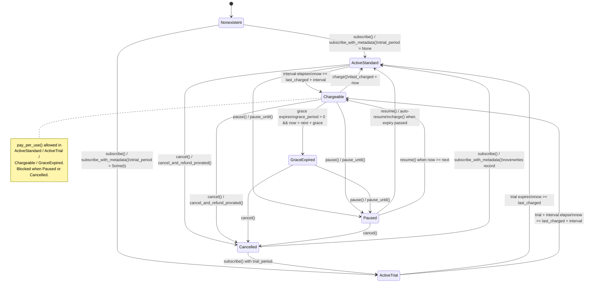

# Subscription Lifecycle State Specification

**Document Version:** 1.0  
**Contract Version:** 2.x  
**Last Updated:** 2026-06-25

---

## Overview

This document defines the formal state transition model for subscription lifecycle management in the FlowPay contract. It serves as the canonical reference for all valid subscription states and the precise conditions under which transitions occur.

---

## Core Subscription State Model

### Data Structure

```rust
pub struct Subscription {
    pub merchant: Address,
    pub amount: i128,
    pub interval: u64,
    pub last_charged: u64,
    pub active: bool,
    pub paused: bool,
    pub token: Address,
    pub referrer: Option<Address>,
    pub label: Symbol,
    pub trial_duration: u64,
    pub created_at: u64,
}
```

### State Dimensions

A subscription exists in a multi-dimensional state space defined by:

1. **Existence**: `Some(Subscription)` or `None`
2. **Activity**: `active: bool`
3. **Pause**: `paused: bool`
4. **Trial Status**: Derived from `last_charged` vs current timestamp
5. **Charge Eligibility**: Derived from `last_charged + interval` vs current timestamp
6. **Grace Period Status**: Derived from `last_charged + interval + grace_period` vs current timestamp

---

## State Definitions

### 1. Nonexistent

**Storage Condition:**

```rust
env.storage().persistent().get(&DataKey::Subscription(user)) == None
```

**Characteristics:**

- No subscription data exists for the user
- Cannot be charged
- Cannot be cancelled
- Can be created via `subscribe()` or `subscribe_with_metadata()`

**Valid Transitions:**

- → **Active (Standard)** via `subscribe()` or `subscribe_with_metadata()`
- → **Active (Trial)** via `subscribe()` or `subscribe_with_metadata()` with `trial_period: Some(u64)`

---

### 2. Active (Standard)

**Storage Condition:**

```rust
Subscription {
    active: true,
    paused: false,
    last_charged: now,  // where now = env.ledger().timestamp() at subscribe time
    ..
}
```

**Characteristics:**

- Fully operational subscription
- `last_charged` equals subscription creation timestamp
- Eligible for charge when `current_time >= last_charged + interval`
- No trial period active

**Valid Transitions:**

- → **Active (Chargeable)** when `current_time >= last_charged + interval`
- → **Paused** via `pause()`
- → **Cancelled** via `cancel()`
- → **Active (Standard)** via `subscribe()` (overwrites existing subscription)

**Operations Allowed:**

- `pay_per_use()`: ✅
- `charge()`: ❌ (IntervalNotElapsed until chargeable)
- `pause()`: ✅
- `cancel()`: ✅

---

### 3. Active (Trial)

**Storage Condition:**

```rust
Subscription {
    active: true,
    paused: false,
    last_charged: now + trial_period,  // future timestamp
    ..
}
```

**Characteristics:**

- Subscription is active but billing is deferred
- `last_charged` is set to a future timestamp (`subscribe_time + trial_period`)
- User can use `pay_per_use()` immediately
- Cannot be charged until trial expires

**Valid Transitions:**

- → **Active (Standard)** when `current_time >= last_charged` (trial expires)
- → **Active (Chargeable)** when `current_time >= last_charged + interval` (trial expires + interval elapses)
- → **Paused** via `pause()`
- → **Cancelled** via `cancel()`

**Operations Allowed:**

- `pay_per_use()`: ✅
- `charge()`: ❌ (IntervalNotElapsed until trial expires)
- `pause()`: ✅
- `cancel()`: ✅

---

### 4. Active (Chargeable)

**Storage Condition:**

```rust
Subscription {
    active: true,
    paused: false,
    last_charged: T,
}
where current_time >= T + interval
```

**Characteristics:**

- Billing interval has elapsed
- Eligible for immediate charge
- Still within grace period (if configured)

**Valid Transitions:**

- → **Active (Standard)** via `charge()` (resets `last_charged` to current timestamp)
- → **Active (Grace Expired)** when `current_time > last_charged + interval + grace_period` (if grace period > 0)
- → **Paused** via `pause()`
- → **Cancelled** via `cancel()`

**Operations Allowed:**

- `pay_per_use()`: ✅
- `charge()`: ✅
- `pause()`: ✅
- `cancel()`: ✅

---

### 5. Active (Grace Expired)

**Storage Condition:**

```rust
Subscription {
    active: true,
    paused: false,
    last_charged: T,
}
where grace_period > 0 && current_time > T + interval + grace_period
```

**Characteristics:**

- Charge window has elapsed
- Grace period has expired
- Charge attempts will fail with `GracePeriodElapsed`
- Subscription remains active but unchargeable until interval advances again

**Valid Transitions:**

- → **Active (Standard)** via `subscribe()` (resets subscription state)
- → **Cancelled** via `cancel()`

**Operations Allowed:**

- `pay_per_use()`: ✅
- `charge()`: ❌ (GracePeriodElapsed)
- `pause()`: ✅
- `cancel()`: ✅

---

### 6. Paused

**Storage Condition:**

```rust
Subscription {
    active: true,
    paused: true,
    ..
}
```

**Characteristics:**

- Subscription exists and is marked active
- All payment operations are blocked
- `last_charged` is frozen (does not advance)
- User retains control and can resume or cancel

**Valid Transitions:**

- → **Active (Standard)** or **Active (Chargeable)** via `resume()` (depends on current time vs `last_charged + interval`)
- → **Cancelled** via `cancel()`

**Operations Allowed:**

- `pay_per_use()`: ❌ (subscription is paused)
- `charge()`: ❌ (subscription is paused)
- `pause()`: ❌ (already paused)
- `resume()`: ✅
- `cancel()`: ✅

---

### 7. Cancelled

**Storage Condition:**

```rust
Subscription {
    active: false,
    ..  // other fields unchanged
}
```

**Characteristics:**

- Subscription exists in storage but is marked inactive
- All payment operations are permanently blocked
- Cannot be resumed
- Can only be replaced by resubscribing

**Valid Transitions:**

- → **Active (Standard)** or **Active (Trial)** via `subscribe()` or `subscribe_with_metadata()` (creates new subscription, overwrites cancelled state)

**Operations Allowed:**

- `pay_per_use()`: ❌ (subscription is not active)
- `charge()`: ❌ (subscription is not active)
- `pause()`: ❌ (subscription is not active)
- `resume()`: ❌ (subscription is not active)
- `cancel()`: ❌ (already cancelled)
- `subscribe()`: ✅ (overwrites)

---

## State Transition Diagram

> Rendered version. The ASCII fallback below it shows the same transitions for plain-text readers. Verified against `contract/src/lib.rs` (`subscribe_inner`, `charge`, `pause`, `pause_until`, `resume`, `cancel`), `contract/src/charge_exec.rs` (`try_auto_resume`, `precheck_charge`) and `contract/src/storage.rs` (`is_cancelled`).



<details>
<summary>ASCII fallback (same transitions)</summary>

```
                    ┌─────────────┐
                    │ Nonexistent │
                    └──────┬──────┘
                           │
         subscribe() or subscribe_with_metadata()
                           │
           ┌───────────────┴───────────────┐
           │                               │
           ▼                               ▼
    ┌─────────────┐              ┌────────────────┐
    │   Active    │              │ Active (Trial) │
    │ (Standard)  │              └───────┬────────┘
    └──────┬──────┘                      │
           │                             │ trial expires
           │                             ▼
           │                      ┌─────────────┐
           │                      │   Active    │
           │                      │ (Standard)  │
           │                      └──────┬──────┘
           │                             │
           │ interval elapses            │ interval elapses
           │                             │
           └─────────────┬───────────────┘
                         │
                         ▼
              ┌──────────────────┐
              │     Active       │
              │  (Chargeable)    │
              └────┬─────────────┘
                   │
         ┌─────────┼─────────┐
         │         │         │
    charge()   grace expires │
         │         │         │
         ▼         ▼         │
    ┌─────────┐ ┌─────────┐ │
    │ Active  │ │ Active  │ │
    │(Standard│ │ (Grace  │ │
    │)        │ │ Expired)│ │
    └────┬────┘ └────┬────┘ │
         │           │      │
         └───────┬───┴──────┘
                 │
         pause() │ cancel()
                 │
       ┌─────────┼──────────┐
       │                    │
       ▼                    ▼
  ┌─────────┐        ┌───────────┐
  │ Paused  │        │ Cancelled │
  └────┬────┘        └─────┬─────┘
       │                   │
   resume()                │
       │                   │
       └────────────────┬──┘
                        │
                   subscribe()
                        │
                        ▼
                 ┌─────────────┐
                 │   Active    │
                 │ (Standard)  │
                 └─────────────┘
```

</details>

---

## Metadata and Storage Extensions

### Subscription Metadata

**Storage Key:** `DataKey::SubscriptionMeta(user)`

**Structure:**

```rust
String // max 64 bytes
```

**Lifecycle:**

- Created via `set_metadata()` or `subscribe_with_metadata()`
- Persists independently of subscription state
- Not deleted on `cancel()`
- Overwritten on subsequent `set_metadata()` or `subscribe_with_metadata()`

### Charge History

**Storage Key:** `DataKey::ChargeHistory(user)`

**Structure:**

```rust
Vec<u64> // last 12 charge timestamps
```

**Lifecycle:**

- Appends a timestamp on each successful `charge()` call
- Capped at 12 entries (FIFO)
- Persists through pause/resume cycles
- Not deleted on `cancel()`

### Referral Data

**Storage Key:** `DataKey::Referral(user)`

**Structure:**

```rust
Address // referrer address
```

**Lifecycle:**

- Set on first `subscribe()` or `subscribe_with_metadata()` call with `referrer: Some(Address)`
- Immutable after first write
- Persists through subscription rewrites
- Not deleted on `cancel()`

---

## Grace Period Behavior

**Global Configuration:** `DataKey::GracePeriod` (instance storage)

**Effect on State Transitions:**

- **When `grace_period == 0` (default):**
  - No grace period enforcement
  - `charge()` succeeds as long as `current_time >= last_charged + interval`
  - No `GracePeriodElapsed` error possible

- **When `grace_period > 0`:**
  - Valid charge window: `[last_charged + interval, last_charged + interval + grace_period]`
  - Before window: `IntervalNotElapsed` error
  - After window: `GracePeriodElapsed` error

**State Integrity:**

- Grace period changes do not retroactively affect existing subscriptions
- Each `charge()` call evaluates grace period against the current global setting

---

## Trial Period Behavior

**Parameter:** `trial_period: Option<u64>` (passed to `subscribe()` or `subscribe_with_metadata()`)

**Implementation:**

```rust
let last_charged = match trial_period {
    Some(period) => now + period,
    None => now,
};
```

**State Implications:**

- Trial subscriptions are immediately **Active** but not **Chargeable**
- `pay_per_use()` works immediately during trial
- First `charge()` can occur at `last_charged + interval` (i.e., `subscribe_time + trial_period + interval`)

---

## Pause/Resume Mechanics

### Pause

**Preconditions:**

- Subscription must exist
- `active == true`

**State Changes:**

```rust
sub.paused = true;
// last_charged unchanged
```

**Effect:**

- Freezes subscription state
- All payment operations blocked
- Time does not advance billing eligibility

### Resume

**Preconditions:**

- Subscription must exist
- `active == true`
- `paused == true`

**State Changes:**

```rust
sub.paused = false;
// last_charged unchanged
```

**Effect:**

- Unfreezes subscription
- Billing eligibility resumes based on original `last_charged` timestamp
- If `current_time >= last_charged + interval` immediately after resume, subscription is **Active (Chargeable)**

---

## Resubscription Behavior

**Operation:** `subscribe()` or `subscribe_with_metadata()` on a user with an existing subscription

**Effect:**

- Completely overwrites the existing subscription struct
- Resets all fields (`merchant`, `amount`, `interval`, `last_charged`, `active`, `paused`, `token`, `referrer`, `label`, `trial_duration`, `created_at`)
- Does not modify `active_count` if previous subscription was active (no double-increment)

**Use Case:**

- Upgrading/downgrading plan
- Switching merchant
- Switching token
- Reactivating a cancelled subscription

---

## Cancel Behavior

**Operation:** `cancel()`

**Preconditions:**

- Subscription must exist

**State Changes:**

```rust
sub.active = false;
// all other fields unchanged
```

**Side Effects:**

- Decrements `ActiveCount` (global counter)
- Emits `cancelled` event
- Does not delete subscription from storage
- Does not delete metadata, charge history, or referral data

---

## Validation and Integrity Constraints

### On Subscribe

1. `amount > 0` — enforced via `assert!`
2. `interval > 0` — enforced via `assert!`
3. `token.allowance(user, contract) >= amount` — enforced via `assert!`
4. If whitelist enabled, `merchant` must be whitelisted — enforced via `ContractError::MerchantNotWhitelisted`

### On Charge

1. Subscription must exist — enforced via `ContractError::NoSubscriptionFound`
2. `active == true` — enforced via `assert!`
3. `paused == false` — enforced via `assert!`
4. `current_time >= last_charged + interval` — enforced via `ContractError::IntervalNotElapsed`
5. If `grace_period > 0`, `current_time <= last_charged + interval + grace_period` — enforced via `ContractError::GracePeriodElapsed`
6. Global volume cap not exceeded — enforced via `ContractError::GlobalVolumeExceeded`

### On Pay-Per-Use

1. `amount > 0` — enforced via `assert!`
2. Subscription must exist — enforced via `expect("no subscription found")`
3. `active == true` — enforced via `assert!`
4. `paused == false` — enforced via `assert!`
5. Daily spending limit not exceeded (if set) — enforced via panic message
6. Global volume cap not exceeded — enforced via `ContractError::GlobalVolumeExceeded`

---

## Global Volume Cap

**Storage:** `DataKey::GlobalVolumeWindow` (instance storage)

**Structure:**

```rust
pub struct GlobalVolumeWindow {
    pub current_window_start: u64,
    pub accumulated_volume: i128,
}
```

**Threshold:** `GLOBAL_MAX_VOLUME_PER_HOUR = 50_000_000_000_000` stroops

**Window Duration:** `HOUR_IN_SECONDS = 3600`

**Behavior:**

- Tracks cumulative transaction volume across all users
- Window resets when `current_time >= current_window_start + 3600`
- Increments on every successful `charge()` and `pay_per_use()` transfer
- Panics with `GlobalVolumeExceeded` if accumulated volume exceeds threshold
- Uses `checked_add` to prevent overflow

**State Integrity:**

- Only successful transfers contribute to volume tracking
- Failed transactions (e.g., insufficient balance) do not increment volume
- Volume check occurs **after** `transfer_from()` succeeds

---

## Contract Pause

**Storage:** `DataKey::ContractPaused` (instance storage, `bool`)

**Effect:**

- When `true`, the operations marked **Blocked** in the matrix below fail with
  `ContractPaused` (18). The check runs before any other validation, so the error is
  the same whatever the other arguments are.
- Readable via `get_protocol_stats().contract_paused` and `is_contract_paused()`
- Controlled by admin via `pause_contract()` and `unpause_contract()`

**Design rule:** the pause stops **money moving** and **new or edited subscriptions**.
It never traps a user. Anything that lets a subscriber leave (cancel, resume their own
pause, remove their own daily cap) stays available, so users can always exit a paused
protocol.

### Pause matrix

Every state-changing public entrypoint of `FlowPay` (read-only getters are never
guarded). The contract tests in `contract/src/test_pause_matrix.rs` enforce each
blocked row and each exit path.

**Decisions for the exit paths in issue #1423:**

- `cancel` and `cancel_and_refund_prorated` stay available. Exiting is never blocked.
- `resume` stays available. It only clears the subscriber's own pause and moves no funds.
  A charge still cannot run while paused, because `charge` is blocked.
- `remove_daily_limit` stays available. It is the user's own bookkeeping and moves no funds.
- `withdraw_merchant_revenue` stays **blocked**. It moves funds out of the contract, so it
  waits for unpause like other fund movements. A merchant sees the same `ContractPaused`
  error whether or not any revenue is pending.
- `migrate` and `finalize_migration` stay available during a pause, so a storage upgrade
  can finish even while the protocol is paused.

<!-- Generated from contract/src/lib.rs (#[contractimpl] block). Keep in sync when adding entrypoints. -->

| Entrypoint | While paused | Notes |
| --- | --- | --- |
| `accept_admin` | Allowed | Not guarded by the pause. |
| `add_merchant` | Allowed | Not guarded by the pause. |
| `batch_cancel` | Allowed | Not guarded by the pause. |
| `batch_charge` | **Blocked** (`ContractPaused`, 18) | No money moves while paused. The whole call fails; there are no per-user results. |
| `batch_extend_subscription_ttl` | Allowed | Not guarded by the pause. |
| `batch_pause_subscriptions` | Allowed | Not guarded by the pause. |
| `bump_instance_ttl` | Allowed | Not guarded by the pause. |
| `bump_merchant_revenue_day` | Allowed | Not guarded by the pause. |
| `bump_subscription` | Allowed | Not guarded by the pause. |
| `cancel_and_refund_prorated` | Allowed | **Exit path.** Always available, including the prorated refund. |
| `cancel_pending_upgrade` | Allowed | Not guarded by the pause. |
| `cancel` | Allowed | **Exit path.** Always available. |
| `charge_with_tip` | **Blocked** (`ContractPaused`, 18) | No money moves while paused (same as `charge`). |
| `charge` | **Blocked** (`ContractPaused`, 18) | No money moves while paused. |
| `clear_charge_history` | Allowed | Not guarded by the pause. |
| `clear_fee` | Allowed | Not guarded by the pause. |
| `clear_merchant_revenue_history` | Allowed | Not guarded by the pause. |
| `clear_metadata` | Allowed | User-owned label. Moves no funds. |
| `clear_subscriber_index_entry` | Allowed | Not guarded by the pause. |
| `commit_fee` | Allowed | Not guarded by the pause. |
| `commit_grace_period` | Allowed | Not guarded by the pause. |
| `commit_upgrade` | Allowed | Not guarded by the pause. |
| `extend_merchant_state_ttl` | Allowed | Not guarded by the pause. |
| `extend_subscriber_index_ttl` | Allowed | Not guarded by the pause. |
| `extend_subscription_ttl` | Allowed | Not guarded by the pause. |
| `extend_trial` | Allowed | User-owned schedule change. Moves no funds. |
| `finalize_migration` | Allowed | Storage upgrade. Allowed so an upgrade can finish during a pause. |
| `freeze_merchant` | Allowed | Not guarded by the pause. |
| `initialize` | Allowed | Not guarded by the pause. |
| `migrate` | Allowed | Storage upgrade. Allowed so an upgrade can finish during a pause. |
| `pause_contract` | Allowed | Sets the pause. |
| `pause_until` | Allowed | User-owned state. Moves no funds. |
| `pause` | Allowed | User-owned state. Moves no funds. |
| `pay_per_use_to` | **Blocked** (`ContractPaused`, 18) | No money moves while paused. |
| `pay_per_use` | **Blocked** (`ContractPaused`, 18) | No money moves while paused. |
| `propose_fee` | Allowed | Not guarded by the pause. |
| `propose_grace_period` | Allowed | Not guarded by the pause. |
| `propose_upgrade` | Allowed | Not guarded by the pause. |
| `prune_charge_history` | Allowed | Not guarded by the pause. |
| `prune_merchant_revenue_days` | Allowed | Not guarded by the pause. |
| `remove_daily_limit` | Allowed | User-owned bookkeeping. Moves no funds. |
| `remove_merchant` | Allowed | Not guarded by the pause. |
| `reset_merchant_revenue` | Allowed | Not guarded by the pause. |
| `resume` | Allowed | **Exit path** for a user's own pause. Moves no funds. |
| `set_daily_limit` | Allowed | User-owned bookkeeping. Moves no funds. |
| `set_fee_bounds` | Allowed | Not guarded by the pause. |
| `set_global_volume_cap` | Allowed | Not guarded by the pause. |
| `set_initial_admin` | Allowed | Not guarded by the pause. |
| `set_keeper_tip_bps` | Allowed | Configuration only. Moves no funds. |
| `set_max_batch_size` | Allowed | Not guarded by the pause. |
| `set_max_whitelist_batch_size` | Allowed | Not guarded by the pause. |
| `set_merchant_fee_recipient` | **Blocked** (`ContractPaused`, 18) | Changes where fees are routed. Waits for unpause. |
| `set_metadata` | Allowed | User-owned label. Moves no funds. |
| `set_min_interval` | Allowed | Not guarded by the pause. |
| `set_subscription_amount` | **Blocked** (`ContractPaused`, 18) | Edits a live subscription. Waits for unpause. |
| `set_subscription_interval` | **Blocked** (`ContractPaused`, 18) | Edits a live subscription. Waits for unpause. |
| `set_whitelist_enabled` | Allowed | Not guarded by the pause. |
| `subscribe_with_metadata` | **Blocked** (`ContractPaused`, 18) | Same as `subscribe`. |
| `subscribe` | **Blocked** (`ContractPaused`, 18) | New subscriptions are blocked while the protocol is paused. |
| `transfer_admin` | Allowed | Not guarded by the pause. |
| `transfer_subscription` | **Blocked** (`ContractPaused`, 18) | Changes subscriber ownership. Waits for unpause. |
| `unfreeze_merchant` | Allowed | Not guarded by the pause. |
| `unpause_contract` | Allowed | Clears the pause. |
| `whitelist_batch_add` | Allowed | Not guarded by the pause. |
| `whitelist_batch_remove` | Allowed | Not guarded by the pause. |
| `withdraw_merchant_revenue` | **Blocked** (`ContractPaused`, 18) | Moves funds out of the contract. Waits for unpause. |

**Current implementation:** the guard is `ensure_contract_not_paused` in `contract/src/lib.rs`,
reached directly or through `subscribe_inner`, `pay_per_use_inner` and `charge_inner`.

---

## Summary of State Flags

| State                  | `active` | `paused` | Chargeable | PPU Allowed |
| ---------------------- | -------- | -------- | ---------- | ----------- |
| Nonexistent            | N/A      | N/A      | ❌         | ❌          |
| Active (Standard)      | `true`   | `false`  | ❌         | ✅          |
| Active (Trial)         | `true`   | `false`  | ❌         | ✅          |
| Active (Chargeable)    | `true`   | `false`  | ✅         | ✅          |
| Active (Grace Expired) | `true`   | `false`  | ❌         | ✅          |
| Paused                 | `true`   | `true`   | ❌         | ❌          |
| Cancelled              | `false`  | *        | ❌         | ❌          |

---

## Appendix: Storage Schema

| Key                      | Type                 | Scope      | TTL                       |
| ------------------------ | -------------------- | ---------- | ------------------------- |
| `Subscription(user)`     | `Subscription`       | Persistent | 6307200 ledgers (~1 year) |
| `SubscriptionMeta(user)` | `String`             | Persistent | Not extended by charge    |
| `ChargeHistory(user)`    | `Vec<u64>`           | Persistent | Not extended by charge    |
| `Referral(user)`         | `Address`            | Persistent | Not extended by charge    |
| `ActiveCount`            | `u64`                | Instance   | Contract lifetime         |
| `GracePeriod`            | `u64`                | Instance   | Contract lifetime         |
| `GlobalVolumeWindow`     | `GlobalVolumeWindow` | Instance   | Contract lifetime         |
| `ContractPaused`         | `bool`               | Instance   | Contract lifetime         |

---

**End of Specification**
